

  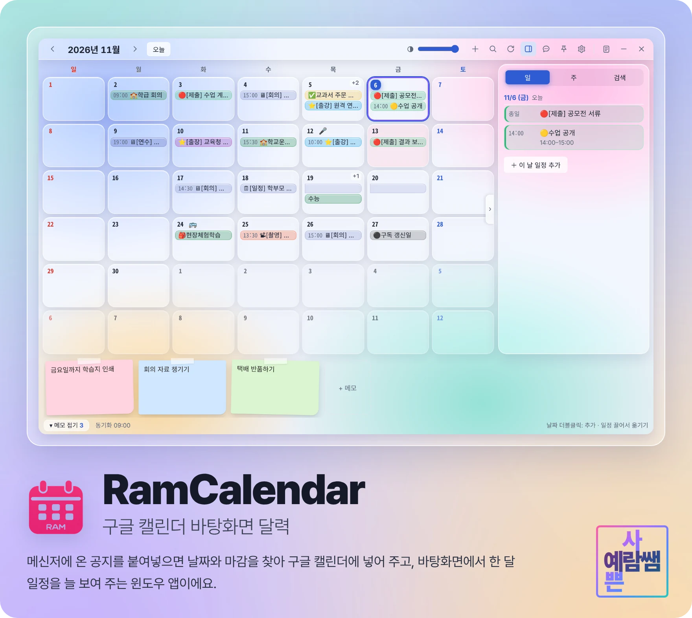

  <a href="https://github.com/dpfkadpfka/yeram-calendar/releases/latest"><b>최신 버전 내려받기</b></a>
  &nbsp;·&nbsp; <a href="#설치">설치</a>
  &nbsp;·&nbsp; <a href="#처음-설정">처음 설정</a>
  &nbsp;·&nbsp; <a href="#자주-묻는-질문">자주 묻는 질문</a>
  &nbsp;·&nbsp; <a href="https://github.com/dpfkadpfka/yeram-calendar/releases">바뀐 점</a>

윈도우 10 · 11 &nbsp;|&nbsp; 무료 &nbsp;|&nbsp; 자동 업데이트

---

## 이런 걸 할 수 있어요

| 기능 | 내용 |
|---|---|
| 일정 도우미 | 메신저 · 공문 · 메일 글을 붙여넣으면 날짜와 마감을 찾아 일정으로 — 한 번에 여러 개도 |
| 바뀐 일정 고치기 | "기한이 변경되었습니다"를 넣으면 기존 일정을 찾아 날짜만 옮겨요 |
| 구글 캘린더 연동 | 휴대폰에서 넣은 일정도 바탕화면 달력에 바로 보여요 |
| 컴퓨터 알림 | 시작 30분 전 화면 오른쪽 아래에 — 휴대폰은 조용히 |
| 꾸미기 | 날짜 칸 색 · 테두리 · 이모지, 포스트잇 메모, 스킨 40가지 넘게 |

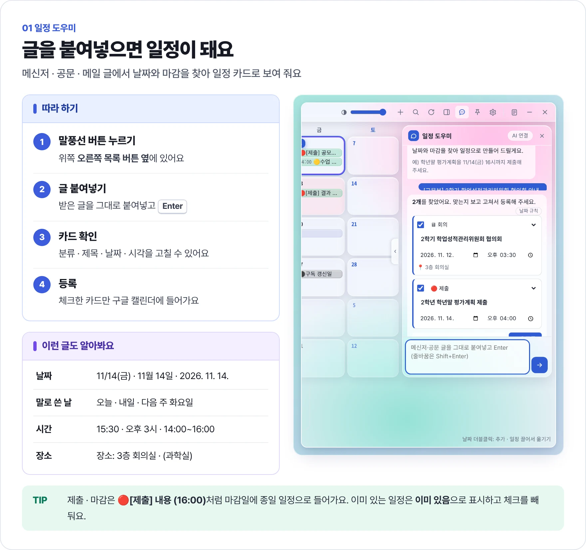

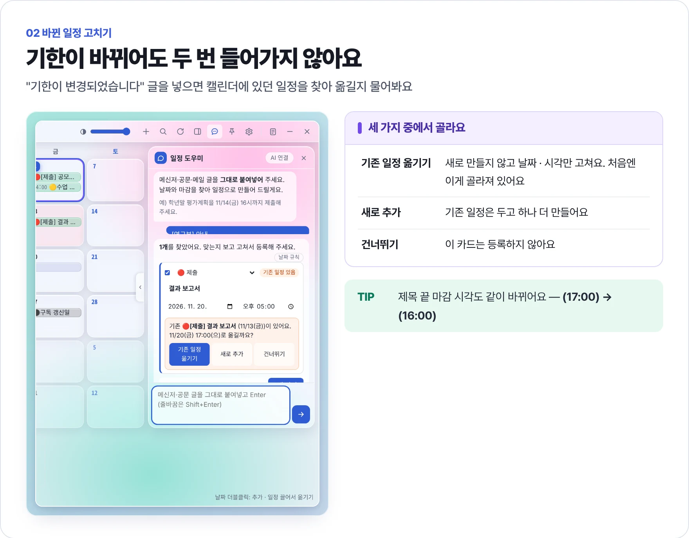

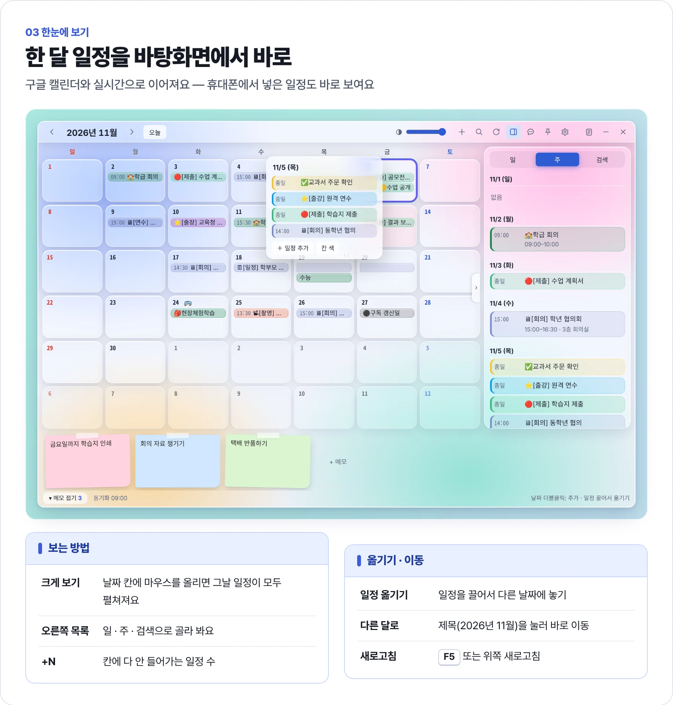

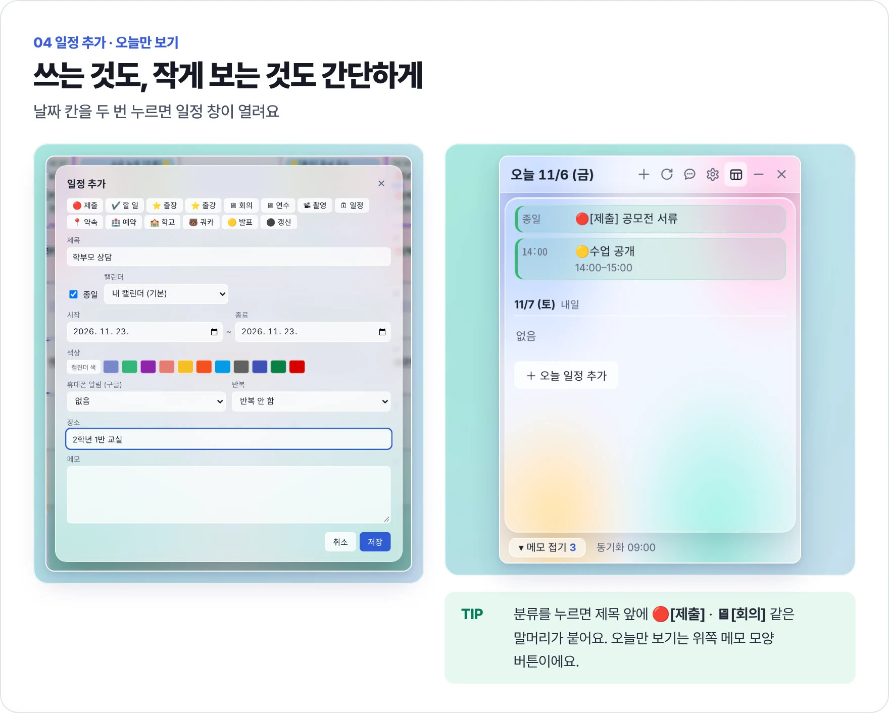

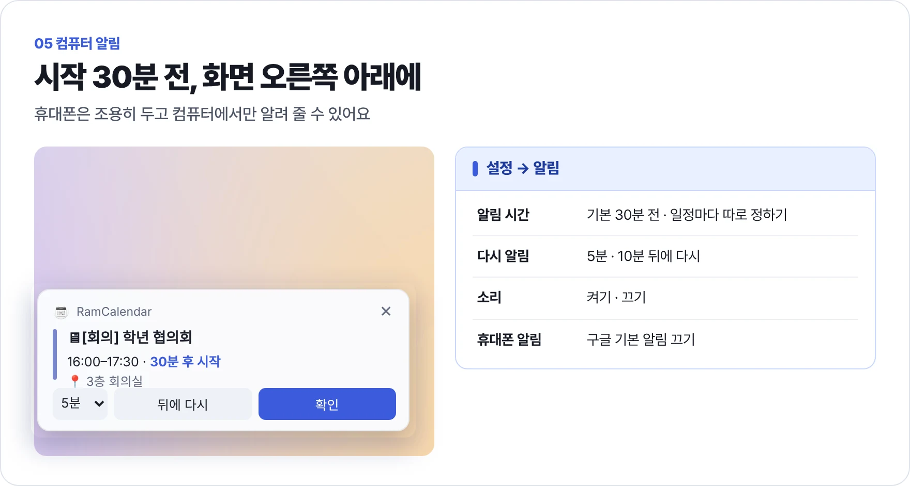

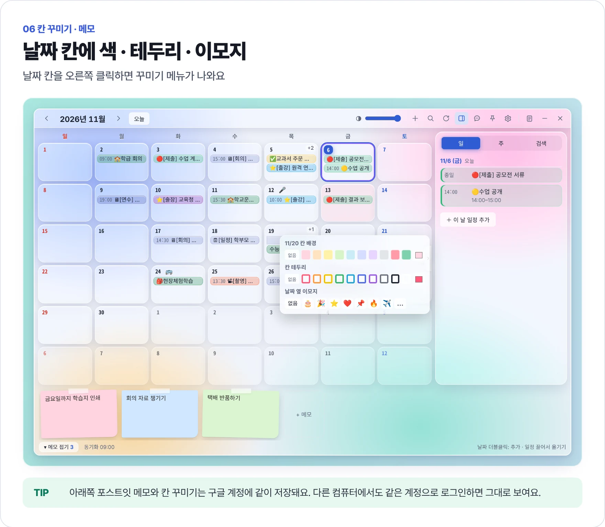

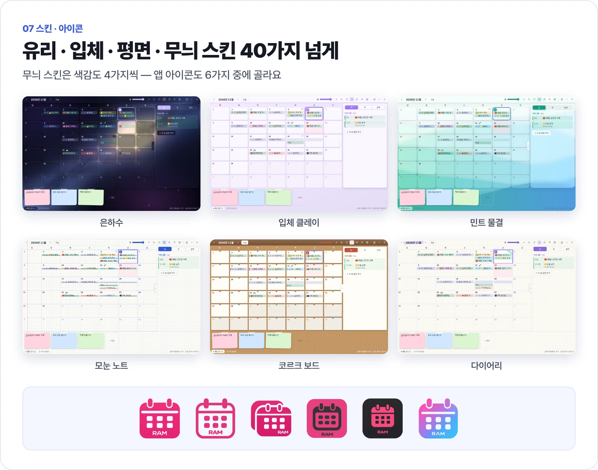

---

## 설치

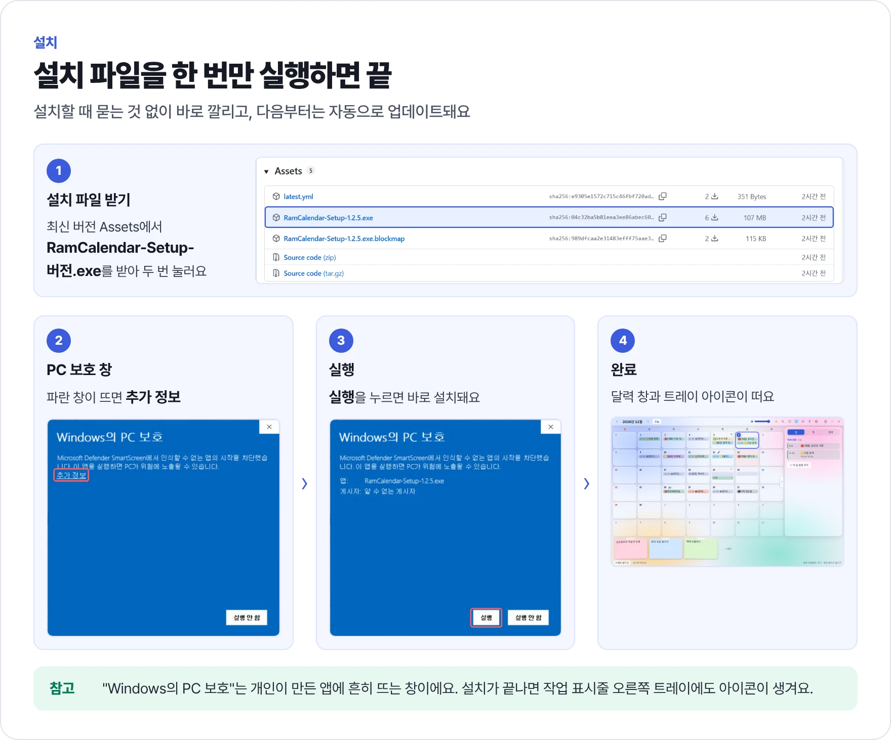

1. [최신 버전](https://github.com/dpfkadpfka/yeram-calendar/releases/latest) 아래 **Assets**에서 `RamCalendar-Setup-버전.exe`를 받아요.
2. 받은 파일을 두 번 눌러요. 파란 **"Windows의 PC 보호"** 창이 뜨면 **추가 정보**를 눌러요.
3. **실행**을 누르면 묻는 것 없이 바로 설치되고 달력 창이 떠요.

새 버전이 나오면 자동으로 받아져서 다음에 켤 때 바뀌어요.

---

## 처음 설정

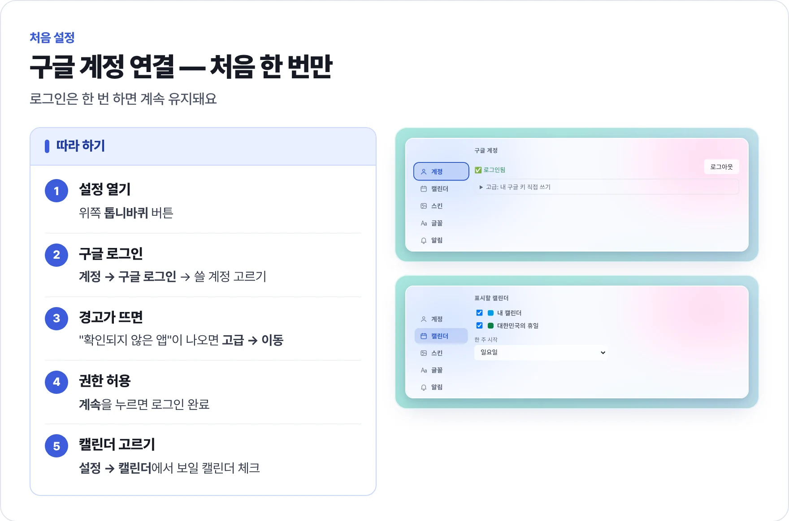

1. 위쪽 **톱니바퀴** 버튼으로 설정을 열어요.
2. **계정 → 구글 로그인**을 누르고 쓸 구글 계정을 골라요.
3. "확인되지 않은 앱"이 나오면 **고급 → 이동**을 눌러요.
4. **계속**을 누르면 로그인이 끝나요. 한 번만 하면 계속 유지돼요.
5. **설정 → 캘린더**에서 달력에 보일 캘린더를 체크해요.

### 더 정확하게 찾고 싶다면 (선택)

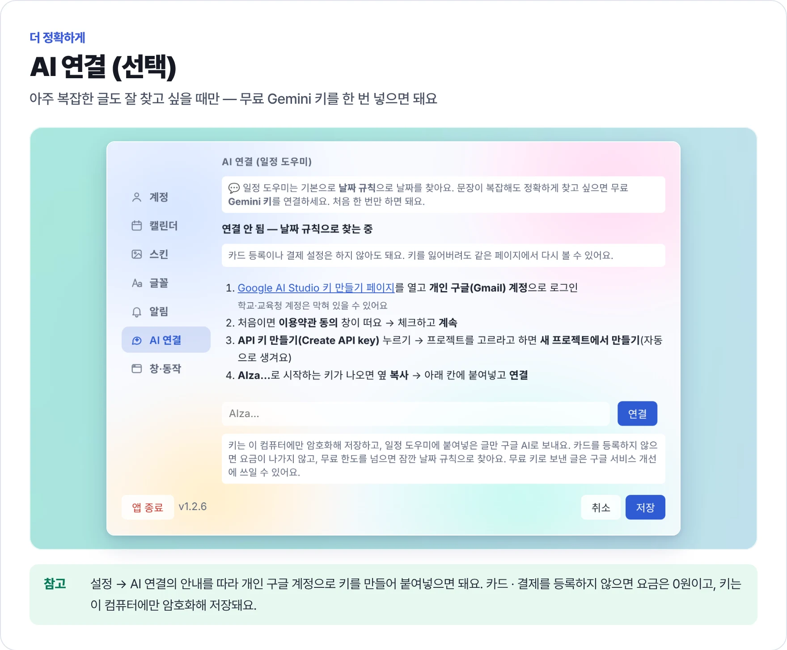

일정 도우미는 기본으로 날짜 규칙으로 찾아요. 아주 복잡한 글까지 잘 찾고 싶을 때만 **설정 → AI 연결**에서 무료 Gemini 키를 넣으세요.
카드 · 결제를 등록하지 않으면 요금은 0원이고, 키는 이 컴퓨터에만 암호화해 저장돼요.

---

## 자주 묻는 질문

<b>"Windows의 PC 보호" 창이 떠요. 설치해도 괜찮나요?</b>

 
개인이 만든 앱이라 처음 실행할 때 흔히 뜨는 창이에요. <b>추가 정보 → 실행</b>을 누르면 설치돼요.

<b>일정이 안 보여요</b>

 
<b>설정 → 캘린더</b>에서 그 캘린더가 체크돼 있는지 보고, 위쪽 새로고침(<kbd>F5</kbd>)을 눌러요.

<b>구글 로그인을 자꾸 하라고 해요</b>

 
한 번 로그인하면 계속 유지돼요. 구글 비밀번호를 바꿨거나 구글 계정에서 앱 연결을 끊었을 때만 <b>설정 → 계정 → 구글 로그인</b>을 다시 해요.

<b>다른 컴퓨터에서도 쓰고 싶어요</b>

 
그 컴퓨터에도 설치하고 같은 구글 계정으로 로그인하면 일정 · 포스트잇 메모 · 칸 꾸미기가 같이 보여요.

<b>알림이 안 와요</b>

 
앱이 켜져 있을 때만 와요. <b>설정 → 알림</b>이 켜져 있는지 보고 <b>알림 미리 보기</b>로 확인해요.

<b>기한이 바뀐 메시지를 넣으면 일정이 두 개가 되나요?</b>

 
아니요. 같은 일정이 있으면 <b>기존 일정 옮기기</b>를 먼저 물어봐요. 같은 날 · 같은 시각 일정은 <b>이미 있음</b>으로 빠져요.

<b>일정 도우미가 날짜를 못 찾아요</b>

 
<b>11/14(금) 16시까지</b>처럼 날짜가 들어간 문장인지 확인해요. 그래도 못 찾으면 <b>설정 → AI 연결</b>을 해 보세요.

<b>AI 키를 넣었는데 "연결되지 않아요"가 떠요</b>

 
키 전체(AIza…)를 다시 복사해 붙여넣어요. 학교 · 교육청 계정으로 만들었다면 개인 구글 계정으로 새로 만들어 보세요.

<b>창이 사라졌어요</b>

 
<b>×</b>는 숨기기예요. 작업 표시줄 오른쪽 트레이(⌃ 안쪽)의 달력 아이콘을 누르면 다시 나와요.

<b>앱을 지우고 싶어요</b>

 
윈도우 <b>설정 → 앱 → 설치된 앱</b>에서 RamCalendar를 <b>제거</b>해요. 구글 캘린더의 일정은 지워지지 않아요.

---

## 바뀐 점

버전마다 바뀐 점은 [Releases](https://github.com/dpfkadpfka/yeram-calendar/releases)에 정리돼 있어요.

---

  만든 사람 <b>김예람</b> (예람쌤) &nbsp;·&nbsp; <a href="https://dpfkadpfka.github.io">예람쌤 홈페이지</a> &nbsp;·&nbsp; <a href="https://dpfkadpfka.github.io/yeram-calendar/privacy.html">개인정보처리방침</a>

새 버전 내보내기 (관리자)

 

1. `package.json`의 `version`을 올려요. (예: 1.2.6)
2. 바뀐 점을 `docs/releases/v버전.md`에 써 둬요. 릴리스 설명으로 그대로 올라가요.
3. Actions의 **설치 파일 만들기**를 실행하면 설치 파일을 만들어 Releases에 올리고, 쓰고 있는 앱들이 자동으로 업데이트돼요.

처음 한 번: 저장소 **Settings → Secrets and variables → Actions**에 `GOOGLE_CLIENT_SECRET`을 등록해요.

